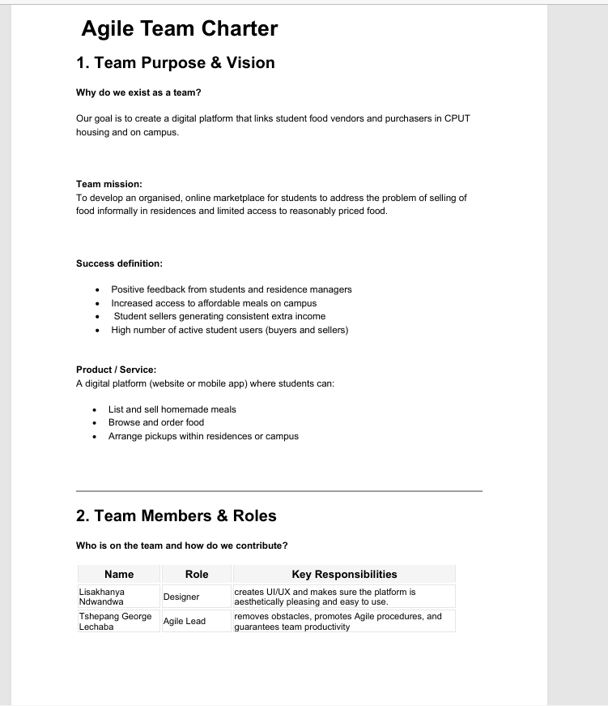

# Section 1: Agile Team Charter

---

## 1. Evidence of Learning

> **Definition:** An Agile team charter is a living social contract created by the team at the start of a project. It sets out our shared purpose, team roles, working agreements, decision-making protocols, and Definition of Done (DoD) to align our daily execution and reduce friction.

### Project Overview: Student Eats
- **Project Goal:** Develop an organized online marketplace connecting student food vendors and buyers in CPUT housing and on campus to address informal residence selling and limited access to reasonably priced food.
- **Team Name:** Student Eats Dev Team
- **Team Members & Official Roles:**
  - **Tshepang George Lechaba:** Agile Lead *(Promotes Agile procedures, removes obstacles, guarantees team productivity)*
  - **Bradley Maelane:** Product Owner *(Creates platform features, manages documentation and content)*
  - **Lisakhanya Ndwandwa:** Designer *(Creates UI/UX, ensures platform accessibility and ease of use)*
  - **Luthando Ndlaku:** Developer *(Creates platform features, oversees content and documentation)*
  - **Thabo Dalisizwe Junior Tutu:** Tester / Presenter *(Evaluates system performance, updates stakeholders on developments)*

---

### Visual Evidence: Team Charter & Communication Agreement

*Figure 1.1: Official signed Student Eats Agile Team Charter document and team working agreements.*

---

### Core Artifacts of Our Team Charter

#### A. Team Purpose & Success Definition
- **Mission:** To provide an organized digital platform where CPUT students can list, browse, and order homemade meals with designated pickup points across residences and campus.
- **Definition of Success:** Positive feedback from students and residence managers, consistent extra income for student vendors, and high active user engagement.

#### B. Ways of Working & Ceremonies (Kanban)
- **Agile Framework:** Kanban workflow.
- **Daily Stand-up:** 15 minutes daily to catch up on progress and flag any blockers.
- **Planning:** Weekly meetings to decide tasks and prioritize work.
- **Review & Demo:** Held at the end of meetings to showcase completed features and collect feedback.
- **Retrospective:** Held at the end of meetings to reflect on performance and identify process improvements.

#### C. Working Agreements & Communication Rules
- **Core Rules:** Show up prepared and on time, make decisions as a team, respect deadlines, give constructive feedback, and maintain honest, respectful communication.
- **Primary Channels:** 
  1. WhatsApp *(Quick daily communication & stand-ups)*
  2. Microsoft Teams *(Meetings & collaborative sessions)*
  3. Outlook *(Formal communication & project updates)*
- **Response Expectations:** Within 1–2 hours during working hours.
- **Decision-Making & Escalation:** Decisions made by consensus or team vote. If stuck, issues are escalated to Tshepang (Agile Lead) for resolution.

#### D. Definition of Done (DoD)
Work is strictly considered **"Done"** when:
1. Feature implementation is complete.
2. Design is finished and accepted.
3. Testing is executed and successful.
4. Documentation is updated.
5. Product Owner (Bradley) gives final approval for platform deployment.

#### E. Known Risks & Constraints
- **Known Risks:** Low student adoption, accommodation management restrictions, low seller participation.
- **Key Constraints:** Time constraints (academic workload), technical skill limitations, and internet/device access dependency.

---

## 2. Structured Reflection

### Reflecting on Team Alignment and Operational Rules

Co-creating our Agile Team Charter provided a strong foundation for how our team operated during the development of *Student Eats*. Defining explicit roles upfront—such as establishing Trello/Agile leadership and Product Owner oversight—ensured every team member understood their responsibilities from day one.

#### What I Personally Learned:
1. **Establishing Clear Communication Protocols:** Setting WhatsApp for fast check-ins and Teams for sprint reviews eliminated miscommunication. The 1–2 hour response expectation kept task handoffs between design, frontend development, and backend API routes moving smoothly.
2. **Value of a Strict Definition of Done (DoD):** Having a formal 5-point DoD prevented us from marking tasks as complete prematurely. A feature wasn't just "done" when the code was written; it required testing by Junior and final sign-off from Bradley.
3. **Managing Project Risks and Constraints:** Formulating our charter made us honest about our academic workload constraints early on. By acknowledging skill gaps and time limits during planning, we kept our sprint scope realistic and manageable.
