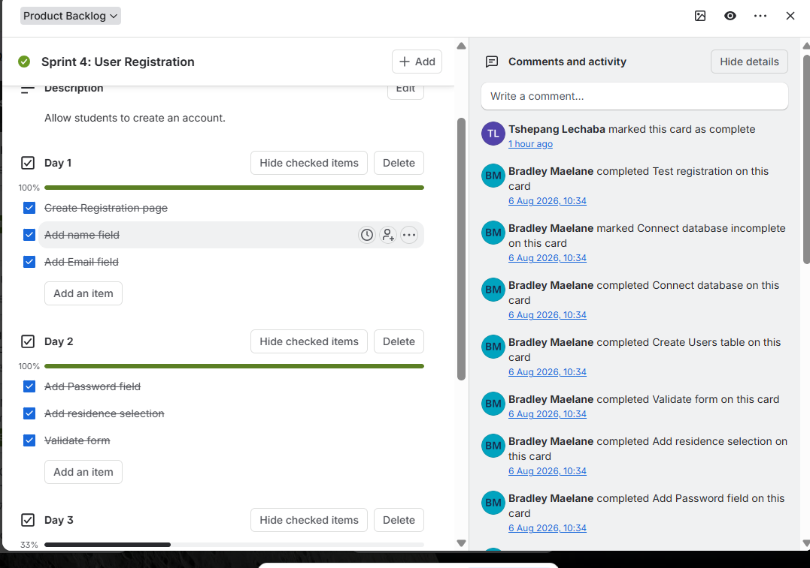
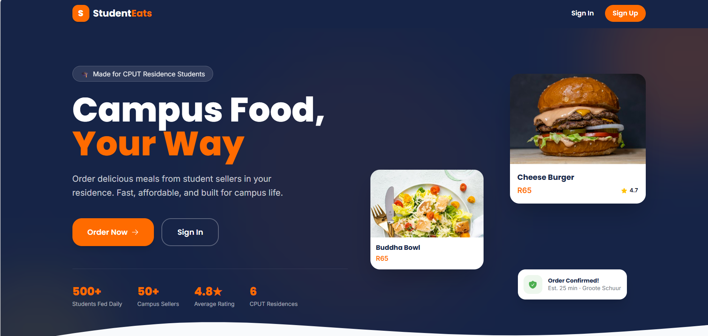
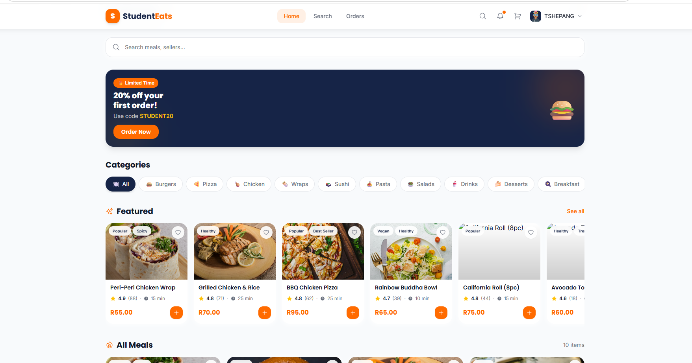
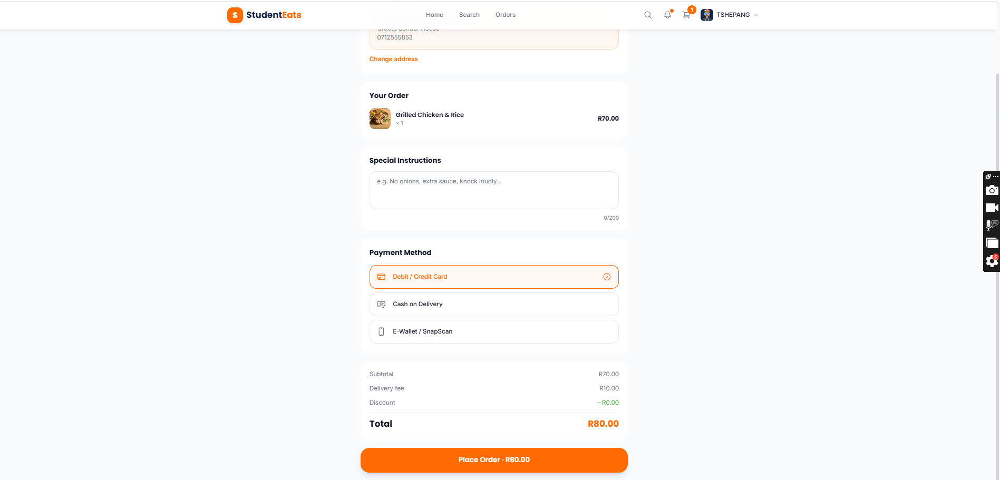

# Section 2: User Stories and Tasks

---

## 1. Evidence of Learning

> **Definition:** A user story in Agile is a short, simple description of a software feature written from the end-user's perspective (*As a... I want... So that...*). In development, user stories are broken down into granular, actionable developer tasks to guide implementation and testing.

### Visual Evidence: User Story Breakdown in Trello

*Figure 2.1: Trello cards showing user stories, acceptance criteria, and sub-task checklists (October 2026).*

---

### Core User Stories & Task Breakdowns (Student Eats)

#### Story 1: Student Registration & Role-Based Authentication
- **User Story:** *As a CPUT student, I want to create an account using my university email address so that I can securely log in and order meals from residence vendors.*
- **Acceptance Criteria:**
  - Email field must validate `@mycput.ac.za` or `@cput.ac.za` domain strings.
  - Passwords must be hashed using `bcrypt` before database persistence.
  - Role selection flag must distinguish between `buyer` and `vendor` accounts.
- **Developer Task Breakdown:**
  1. [Frontend] Design React registration form layout with real-time input validations.
  2. [Backend] Create Express POST endpoint `/api/auth/register`.
  3. [Database] Define `users` table schema in MySQL with role flags.
  4. [QA] Execute unit testing on valid vs. invalid email formats and password lengths.

*Figure 2.2: User Registration Interface with CPUT email domain validation.*

---

#### Story 2: Marketplace Discovery & Filter
- **User Story:** *As a student buyer, I want to browse available meals and filter by residence location so that I can quickly find affordable food options nearby.*
- **Acceptance Criteria:**
  - Render interactive meal cards displaying price, vendor name, and pickup location.
  - Filter listings dynamically based on residence selection (e.g., Freedom Square, Catsville).
- **Developer Task Breakdown:**
  1. [Frontend] Build responsive meal grid component in React.
  2. [Backend] Build Express GET endpoint `/api/products` with query parameter filtering.
  3. [Database] Store product listings with image URLs and vendor foreign keys.

*Figure 2.3: Student Eats marketplace meal discovery grid.*

---

#### Story 3: Cart Management & Pickup Checkout
- **User Story:** *As a buyer, I want to place items in a shopping cart and select my pickup spot so that I can confirm my meal order.*
- **Acceptance Criteria:**
  - Dynamic total calculation based on selected menu items and quantities.
  - Checkout confirmation screen displaying order summary and estimated pickup time.
- **Developer Task Breakdown:**
  1. [Frontend] Create React Context for cart state management (add/remove items).
  2. [Frontend] Design checkout screen with pickup residence dropdown menu.
  3. [Backend] Create Express POST endpoint `/api/orders` to persist order records.

*Figure 2.4: Shopping Cart and Residence Pickup Checkout Screen.*

---

## 2. Structured Reflection

### Reflecting on End-User Perspective and Feature Prioritization

Structuring the *Student Eats* platform around user stories significantly transformed how our team approached project features. Initially, our focus was purely technical—setting up server endpoints and database schemas. However, framing development through the "As a... I want... So that..." structure re-centered our focus on end-user value.

#### Key Takeaways & Impact on Execution:
1. **Focusing on End-User Value:** Drafting user stories forced us to consider real user constraints early. For instance, requiring CPUT email validation ensured platform safety and trust between student buyers and vendors.
2. **Granular Task Decomposition:** Splitting high-level user stories into clear backend, frontend, and database tasks prevented developer overwhelm. Team members could take complete ownership of individual full-stack slices (e.g., cart state management or authentication endpoints).
3. **Evolution of Learning:** Defining acceptance criteria prior to writing code proved essential for quality assurance. Clear acceptance criteria minimized ambiguity during integration testing and ensured feature completeness before merging code into our main branch.
