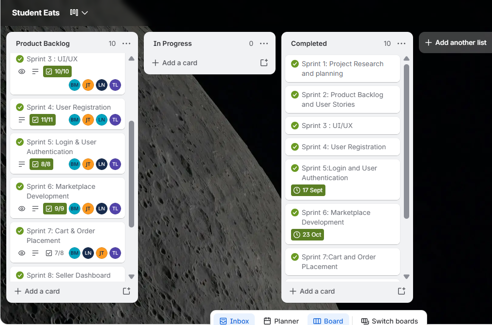

# Section 3: Product Backlog

---

## 1. Evidence of Learning

> **Definition:** A product backlog is a single, prioritized list of every feature, fix, and task needed for the project. It gets updated continuously as priorities change and as the development team completes deliverables throughout the project lifecycle.

### Visual Evidence: Trello Product Backlog Board

*Figure 3.1: Complete Product Backlog organized on Trello.*

---

### Student Eats Completed Backlog Table

We organized our Product Backlog on Trello using the MoSCoW method (Must have, Should have, Could have, Won't have), prioritizing core features for CPUT student buyers and vendors first. Every item in our product backlog has now been fully developed, tested, and marked as completed:

| Priority | Item ID | Feature / Module | User Story & Summary | Target Sprint | Status |
| :--- | :--- | :--- | :--- | :--- | :--- |
| **Must Have** | PB-01 | Registration & Auth | Student CPUT email check, password encryption, role selection (`buyer`/`vendor`). | Sprint 4 & 5 | Completed |
| **Must Have** | PB-02 | Cart & Checkout | Shopping cart state, pickup residence selection, total price calculation. | Sprint 7 | Completed |
| **Must Have** | PB-03 | Vendor Dashboard | Seller screen to upload menu items, set prices, and update stock status. | Sprint 8 | Completed |
| **Should Have** | PB-04 | Marketplace Filter | Filter meal cards by residence venue and dietary preference. | Sprint 6 | Completed |
| **Should Have** | PB-05 | Order Status | Live order pipeline (`Placed` $\rightarrow$ `Preparing` $\rightarrow$ `Ready for Pickup`). | Sprint 7 | Completed |
| **Could Have** | PB-06 | System Docs & Testing | Final UI testing, bug fixes, and project documentation/slides. | Sprint 9 & 10 | Completed |

---

## 2. Structured Reflection

### Reflecting on Backlog Completion and Delivering the MVP

Seeing every item on our *Student Eats* product backlog reach "Completed" status was a major milestone for our team. Managing this backlog was all about making realistic choices—focusing on our core MVP first and making sure every single task was thoroughly implemented and tested before final submission.

#### What I Personally Learned:
1. **Building an MVP First:** Grouping items into "Must Haves" vs. "Could Haves" saved our project. It forced us to finish core features like registration, marketplace browsing, and cart checkout early, which gave us enough time to finish secondary items like order status tracking and system documentation.
2. **Tracking Technical Tasks:** Putting technical chores—like fixing CORS errors and setting up database tables—directly on the backlog alongside user features ensured we maintained backend health throughout development.
3. **Growth as a Developer:** I learned that a backlog is a roadmap for team accountability. Seeing the entire backlog reach 100% completion gives us total confidence that our web app meets every user story and project requirement we set out to build.
