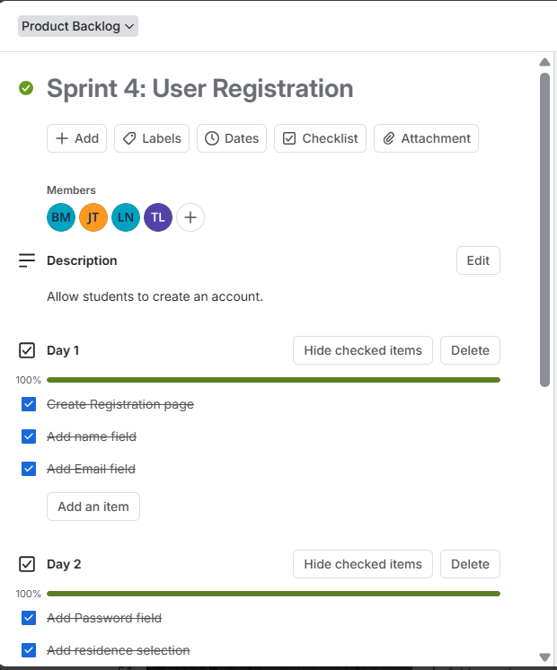
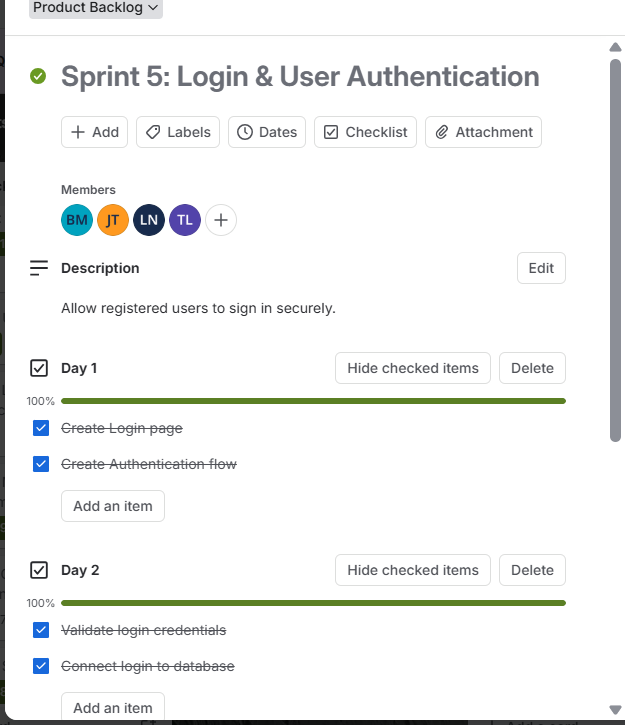

# Section 4: Sprint Backlog

---

## 1. Evidence of Learning

> **Definition:** A Sprint Backlog is an actionable plan created by developers during sprint planning. It breaks down larger features from the Product Backlog into specific, day-by-day tasks that the team commits to finishing during that sprint cycle.

### Our Sprint Backlogs in Action (Student Eats)

Below is the complete task breakdown and Trello evidence from our actual development workflow during Sprint 4 and Sprint 5:

#### Sprint 4: User Registration
- **Sprint Goal:** Build and test a complete registration flow so new student users can create accounts with their details.
- **Assigned Team Members:** Bradley Maelane (BM), Junior Tutu (JT), Luthando Ndlaku (LN), Tshepang Lechaba (TL)

*Figure 4.1: Trello card breakdown for Sprint 4 (User Registration) across Days 1–4.*

**Daily Breakdown & Tasks Completed:**
- **Day 1:**
  - [x] Create Registration page
  - [x] Add name field
  - [x] Add Email field
- **Day 2:**
  - [x] Add Password field
  - [x] Add residence selection
- **Day 3:**
  - [x] Create Users table
  - [x] Connect database
  - [x] Save user details
- **Day 4:**
  - [x] Test registration
  - [x] Fix bugs

---

#### Sprint 5: Login & User Authentication
- **Sprint Goal:** Allow registered students to log in securely, handle password recovery, and display clear feedback when errors happen.
- **Assigned Team Members:** Bradley Maelane (BM), Junior Tutu (JT), Luthando Ndlaku (LN), Tshepang Lechaba (TL)

*Figure 4.2: Trello card breakdown for Sprint 5 (Login & User Authentication) across Days 1–4.*

**Daily Breakdown & Tasks Completed:**
- **Day 1:**
  - [x] Create Login page
  - [x] Create Authentication flow
- **Day 2:**
  - [x] Validate login credentials
  - [x] Connect login to database
- **Day 3:**
  - [x] Add Forgot Password
  - [x] Display error messages
- **Day 4:**
  - [x] Test Login
  - [x] Resolve issues

---

## 2. Structured Reflection

### Reflecting on Daily Execution and Problem-Solving

Breaking our work down into a 4-day checklist for each sprint was a game-changer for our team. When we first looked at "User Registration" or "Login", those sounded like huge technical mountains. Splitting them into bite-sized daily tasks gave us a realistic roadmap and made tracking our daily progress effortless.

#### Key Takeaways & Human Lessons:
1. **Staying Accountable Every Day:** Seeing green progress bars reach 100% at the end of each day kept us motivated. We always knew who was working on what—for instance, while the frontend UI fields were being laid out on Days 1 and 2, backend database scripts were being prepped for Days 3 and 4.
2. **Planning for Testing and Bug Fixing:** Dedicating Day 4 specifically to testing and bug fixes saved us from last-minute stress. During Sprint 5, for example, testing helped us catch missing error feedback messages when a user typed the wrong password, allowing us to fix it before moving on.
3. **What I Learned as a Developer:** I realized that software development isn't just about writing code all at once; it's about steady pacing. Having clear, small check-boxes meant we spent less time wondering "what should I do next?" and more time actually getting things done.
