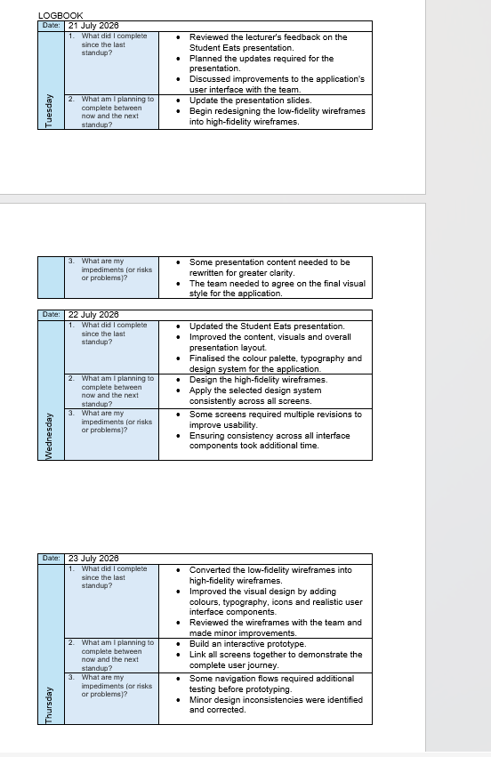

# Section 5: Agile Logbook

---

## 1. Evidence of Learning

> **Definition:** An Agile Logbook is a tracking tool used by project managers and development teams to record daily stand-ups, sprint plans, retrospective notes, identified blockers, and continuous process improvements.

### Visual Evidence: Daily Stand-Up Logs & Retrospective Notes

*Figure 5.1: Excerpt from team stand-up logs and sprint retrospective meeting notes (October 2026).*

---

### Sample Sprint Logbook & Retrospective Entries (Student Eats)

Below are representative excerpts from our team's Agile Logbook documenting daily stand-up logs, technical blockers, and sprint retrospective reflections:

#### Log Entry 1: Daily Stand-up Notes
- **Date:** 12 October 2026
- **Attendees:** Tshepang Lechaba, Bradley Maelane, Junior Tutu, Luthando Ndlaku
- **Progress Updates:**
  - *Tshepang (Project Manager / Full-Stack):* Configured MySQL database tables for user roles and built Express registration endpoints.
  - *Bradley (Frontend Lead):* Completed React UI layout and form validation for the user registration screen.
  - *Junior (Backend Lead):* Set up database connection pool and environment configuration variables.
  - *Luthando (QA Lead):* Drafted unit test cases for CPUT email domain validation (`@mycput.ac.za`).
- **Blockers Identified:** CORS policy errors when attempting to connect the React frontend (running on Vite port 5173) to the Express backend (running on port 5000).
- **Resolution:** Updated Express middleware configuration using `cors()` and established standard environment variable files (`.env`).

#### Log Entry 2: Sprint Retrospective Summary
- **Date:** 19 October 2026
- **Sprint Reviewed:** Sprint 6 & 8 (Marketplace Development & Seller Dashboard)
- **What Went Well:** Frontend React component designs were delivered ahead of schedule and aligned cleanly with wireframe layouts.
- **What Could Be Improved:** Unclear REST API query parameters led to minor delays during frontend-backend endpoint integration.
- **Action Items for Next Sprint:** Establish clear API route parameters and payload contracts before starting frontend API integration hooks.

---

## 2. Structured Reflection

### Reflecting on Retrospectives and Continuous Improvement

Maintaining an Agile Logbook provided our development team with an accurate audit trail of team progress, individual contributions, and technical problem-solving. While task boards showed *what* was being built, the logbook captured *how* our process evolved over time.

#### Key Takeaways & Impact on Execution:
1. **Promoting Team Accountability:** Logging daily stand-ups ensured that technical blockers—such as CORS errors or database schema mismatches—were flagged and addressed immediately rather than stalling progress for days.
2. **Actionable Retrospectives:** Sprint retrospectives created a structured space for open feedback. Discussing workflow friction enabled us to improve our API contracts and streamline code reviews.
3. **Evolution of Learning:** As a developer, keeping this logbook demonstrated the value of reflective practice. Documenting technical roadblocks and their solutions built a valuable knowledge base that accelerated troubleshooting in later sprints.
